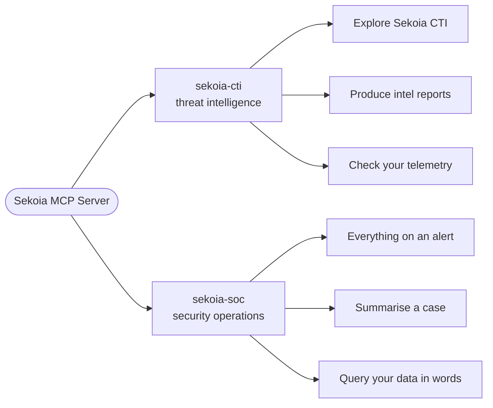
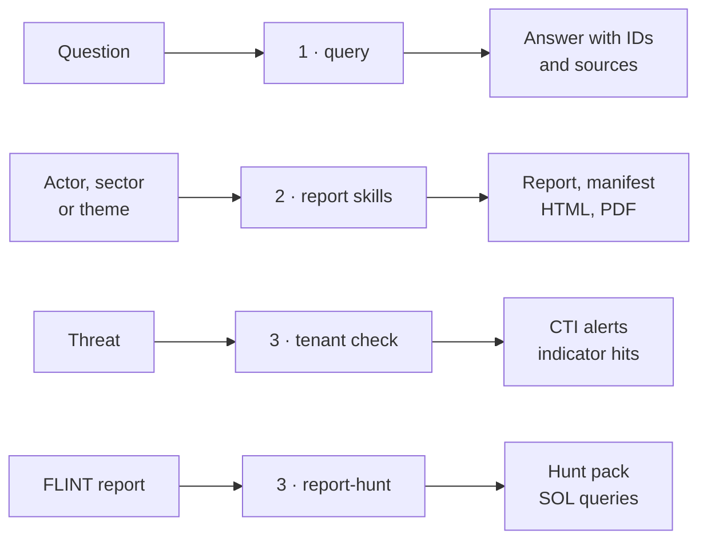
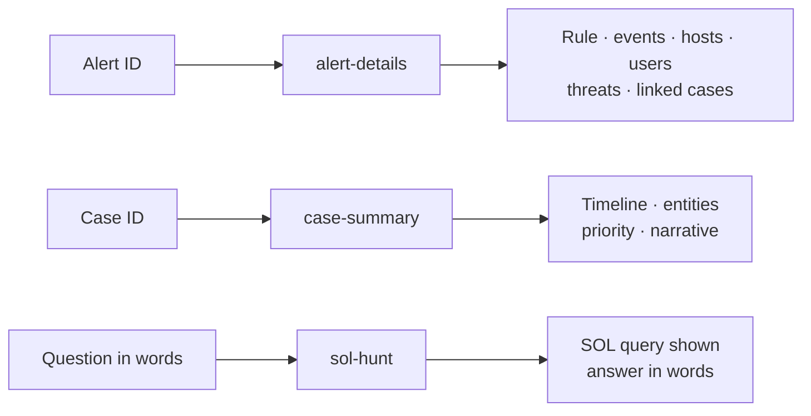

# Sekoia plugins for Claude Code

Ask Sekoia threat intelligence and your Sekoia SOC data in plain language, straight from Claude Code. The plugins connect Claude to the [Sekoia MCP Server](https://docs.sekoia.com/integration/mcp/overview/) and add skills that turn a question into the right tool calls, the right fields and the right queries. Everything is read-only, and every answer cites the Sekoia IDs it rests on.

## At a glance



| Plugin | For | Skills |
|---|---|---|
| [`sekoia-cti`](plugins/sekoia-cti/README.md) | CTI analysts, detection engineers, anyone who needs Sekoia threat intelligence | `query`, `exposure-assessment`, `threat-horizon-assessment`, `intelligence-delta`, `evidence-protocol`, `report-hunt` |
| [`sekoia-soc`](plugins/sekoia-soc/README.md) | SOC analysts working alerts, cases and hunts on their Sekoia community | `alert-details`, `case-summary`, `sol-hunt` |

## Threat intelligence: from a question to your telemetry

The CTI plugin follows the analyst's path: explore what Sekoia knows, write it up, then check whether it touches you.



### 1. Explore Sekoia CTI

**`query`** answers ad hoc questions on actors, malware, indicators, CVEs, sectors, campaigns and reports. You get a few sentences with the STIX IDs, confidence, dates and platform links behind them. You also learn which Sekoia source produced the evidence (C2 Tracker, Honeypot, Malware Watcher…), and what was searched and not found.

```
What does Sekoia know about RedMike?
Which actors carry out sabotage against the energy sector?
```

### 2. Produce intelligence reports

| Skill | What it is for | You get |
|---|---|---|
| `exposure-assessment` | How an actor or campaign exposes a sector or an organisation; sector technical RFIs | Markdown report, evidence manifest, HTML, PDF |
| `threat-horizon-assessment` | How a threat theme will evolve over 3 to 12 months, and what to watch | Markdown report, evidence manifest, HTML, PDF |
| `intelligence-delta` | What Sekoia adds that a generic feed does not, proven on one finding | Markdown brief, evidence manifest, HTML, PDF |

All three apply **`evidence-protocol`**. Every claim is typed (fact, calculated result, assessment…) and traced to a Sekoia object or relationship ID. Clusters are never merged and dates are never borrowed between objects. The evidence manifest ships next to the report, which renders in the Sekoia Intelligence design.

```
Produce a Sekoia Intelligence Exposure Assessment on TeamTNT for cloud-native SaaS providers.
```

### 3. Check your telemetry

**Were we exposed to this threat?** The tenant check in `query` takes the IDs it just retrieved and asks your Sekoia community two questions:
- did Sekoia CTI already raise alerts on them?
- do their indicators (domains, URLs, hashes, IPs) appear in your events?

```
Has Sekoia CTI on APT28 or its infrastructure fired in our tenant over the last 30 days?
```

**Are this report's behaviours in our logs?** Indicators are already covered by Sekoia's detection; techniques are not. **`report-hunt`** reads a FLINT report. It then maps each described behaviour to the log sources you have and lists the built-in rules that already cover it. For the rest, it writes bounded SOL queries built from the report's exact strings.

```
Build a hunt pack from FLINT 2026-011 on EvilTokens: which behaviours can our telemetry see, which rules cover them, and the queries for the rest.
```

Hits are leads for the SOC, not attribution. An empty result is reported with its window and data sources, never as "not exposed".

## SOC: alerts, cases and your data in plain language



Each skill offers the next pivot: from an alert to its case, from a case or an alert to a hunt on its hosts and users.

| Skill | What it is for | You get |
|---|---|---|
| `alert-details` | Everything Sekoia holds on one alert | Rule, events, hosts, users, files, network values, threats with CTI context, linked cases and assets. Facts only, no verdict |
| `case-summary` | Briefing the next shift, a manager or a customer | A timeline of the case's alerts, the entities involved, its priority, a five-line narrative |
| `sol-hunt` | Any question on events, alerts, cases, assets or rules | The SOL query it ran, shown so you can rerun it, and the result read back in words |

```
Get everything on alert <short_id>.
Summarise case <short_id> as a timeline and a five-line narrative.
When did <user> last sign in successfully, and from which IP? Look at the last 30 days.
```

## Quick start

1. **Create an API key** in Sekoia (**Settings > API Keys**, see [Manage API keys](https://docs.sekoia.com/getting_started/manage_api_keys/)) with the [permissions](#permissions) of the plugin you want.
2. **Export it** in the shell that starts Claude Code. Never write it into a file that could be committed.
   ```bash
   export SEKOIA_API_KEY="YOUR_API_KEY"
   ```
3. **Install** the marketplace and one or both plugins:
   ```
   /plugin marketplace add SEKOIA-IO/claude-marketplace
   /plugin install sekoia-cti@sekoia
   /plugin install sekoia-soc@sekoia
   ```
4. **Check** with `/mcp` that the `sekoia` server is connected. The tools listed depend on the key's permissions.

Then ask in plain language; Claude picks the matching skill. You can also call one by name, for example `/sekoia-cti:query` or `/sekoia-soc:sol-hunt`.

Both plugins declare the same server (`https://api.sekoia.io/v1/generative/mcp/`). Installing both is harmless: the tools are namespaced per plugin.

## Permissions

| Plugin | Permissions on the API key |
|---|---|
| `sekoia-cti` | `View intelligence`; add `View query builder data sources` and `Execute query` for tenant checks and hunt packs against your own telemetry |
| `sekoia-soc` | `View alerts`, `View cases`, `View events`, `View Rules Catalog`, `View query builder data sources`, `Execute query`; `View intelligence` for the CTI context of alerts |

A key with fewer permissions still works: the skills say which step they skipped and which permission is missing.

## Update

Refresh the marketplace, then update each installed plugin. From a terminal:

```bash
claude plugin marketplace update sekoia
claude plugin update sekoia-cti@sekoia
claude plugin update sekoia-soc@sekoia
```

Inside Claude Code, run `/plugin marketplace update sekoia`, then open `/plugin manage` to update the installed plugins. Restart Claude Code to load the new version. [`CHANGELOG.md`](CHANGELOG.md) lists what changed in each release.

## More example prompts

<details>
<summary><code>sekoia-cti</code></summary>

```
Is 203.0.113.42 known to Sekoia CTI?
Which actors does Sekoia link to CVE-2023-20198?
Which Sekoia reports cover Salt Typhoon?
Are we exposed to TeamTNT? Summarise the actor, list its malware and tools, then check our events for the related indicators over the last 30 days.
Build a hunt pack from FLINT 2026-037 and check which behaviours our telemetry can see.
Build a telecommunications technical RFI on Salt Typhoon edge-device exploitation and router persistence.
```

</details>

<details>
<summary><code>sekoia-soc</code></summary>

```
Which host and user are behind alert <short_id>?
How many alerts did the rule "SEKOIA Intelligence Feed" raise in the last 7 days, by threat? Then list the 10 most urgent.
Did any host resolve <domain> in the last 30 days?
Which log sources do we have in Sekoia?
```

</details>

The report skills print the PDF from the HTML with a local Chrome or Chromium; without one, the markdown, manifest and HTML are still produced.

## Documentation

- [Sekoia MCP Server](https://docs.sekoia.com/integration/mcp/overview/)
- [Install in Claude Code](https://docs.sekoia.com/integration/mcp/install_claude_code/)
- [Threat intelligence how-to guides](https://docs.sekoia.com/integration/mcp/how_to_cti/)
- [SOC how-to guides](https://docs.sekoia.com/integration/mcp/how_to_soc/)
- [MCP tools](https://docs.sekoia.com/integration/mcp/tools_reference/)
- [Sekoia Operating Language (SOL)](https://docs.sekoia.com/xdr/features/investigate/sol_overview/)

## Repository layout

```
.claude-plugin/marketplace.json
plugins/sekoia-cti/   .claude-plugin/plugin.json, .mcp.json, skills/
plugins/sekoia-soc/   .claude-plugin/plugin.json, .mcp.json, skills/
```

## License

Apache-2.0. See [`LICENSE`](LICENSE).
