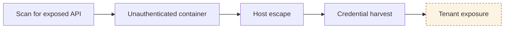
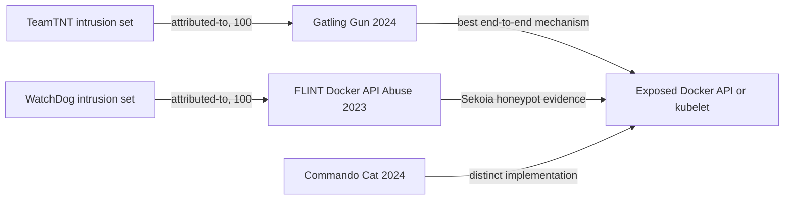
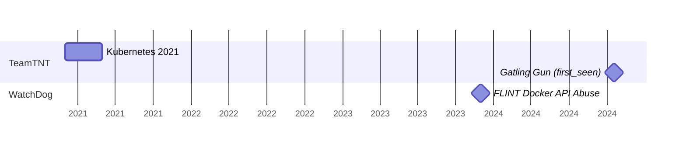

# Figures

Contents: when a figure earns its place · two lanes · six archetypes · geometry · fact discipline · voice

A figure earns its place when it lets a cold reader see a mechanism they would otherwise assemble from prose: which steps the evidence covers, which clusters stay apart, which source establishes what, when each observation sits on the axis. If a sentence says it faster, write the sentence. Skip the figure when the chain has three steps or fewer, when one cluster is tracked, or when a timeline holds two dates.

## Two lanes, one source of truth

Every figure is drawn twice from the same step list, label list or date list:

- **Markdown lane**: a Mermaid fence directly under the paragraph it illustrates. Obsidian and most markdown viewers render it; elsewhere it reads as text.
- **HTML lane**: inline SVG filled from the matching template in `assets/diagram_*.svg`, placed at the same position. No `<script>`, `<style>`, `<foreignObject>` or external reference inside the SVG. Native shapes and `<text>` only. Wrapped in `<figure>` with a `<figcaption>` stating the claim, and `role="img"` plus `aria-label` carrying the same claim.

Strokes and text use `currentColor`; the page sets `figure svg{color:var(--navy)}`. One literal hue carries meaning: amber (`#b45309` stroke, `#fdf3e3` fill) for the exposure-model step, the target control or the "separate, not merged" note. Wash fills (`#eef5fb`) for ordinary boxes. Grey (`#7d8aa0`) for revoked or absent items.

## Archetypes

| # | Figure | Claim it carries | Report types | Template |
|---|---|---|---|---|
| 1 | Mechanism chain | These are the steps, and this one is a model | Exposure, RFI, horizon (per mechanism, four or more steps), delta | `diagram_chain.svg` |
| 2 | Cluster map | These clusters share a surface and nothing else; attribution is per cluster | Exposure and RFI with two or more clusters; RFI naming arbitration | `diagram_clusters.svg` |
| 3 | Observation timeline | These observations are separately dated on one axis | Exposure, RFI (two lane groups: observation windows above, ingested report publications below) | `diagram_timeline.svg` |
| 4 | Source layers | This source establishes that status | RFI | `diagram_sources.svg` |
| 5 | Horizon strip | Evidence window, today, 3 and 12 months, forecasts with confidence | Horizon | `diagram_horizon.svg` |
| 6 | Evidence tree | One finding, three branches, confidence per branch | Delta | `diagram_tree.svg` |

The integrity model in "Why this matters" reuses the chain template: the controls the operator should be able to prove, last pill highlighted.

### 1. Mechanism chain (house pill style)

Rounded pills on a wash fill, thin arrows between them, the model or target pill filled amber with a dashed stroke. Arrow labels name the artefact that moves (config, credential, token) when it changes between steps; otherwise leave the arrow bare. Up to five pills per row; longer chains wrap with the elbow connector in the template. Two entry doors merge with the fork group in the template. A dashed amber note box under the chain carries the "separate, not merged" statement when a second episode must not be joined.

Mermaid:

### 2. Cluster map

Three columns, one row per cluster, no edge between rows. Left: the attribution node with the attributed-to relationship and its confidence on the edge. Middle: the cluster. Right: the shared surface, one tall box spanning the rows, with the cluster's role on the edge. A cluster with no attribution relationship has an empty left cell and the text "no attributed-to relationship" in grey. For naming arbitration the same grid holds vendor names on the left, the Sekoia object in the middle and revoked duplicates greyed.

Mermaid:

### 3. Observation timeline

One lane per cluster or source, label column on the left, date axis at the bottom with year ticks. A filled dot marks first_seen. A bar from first_seen to last_seen is drawn for indicators only; last_seen on other objects is not plotted. A hollow dot is a publication date with no observation window. Two lane groups, separated by a rule and a group label, keep observation windows apart from ingested report publication dates so the anti-double-counting note is visible.

Mermaid (gantt renders windows and milestones). Every milestone label is the event name ("FBI and CISA Nov 2024"); the hollow-dot style is an HTML SVG convention and never appears as a label in the fence:

### 4. Source layers

Left column: Sekoia first-party observation, ingested vendor reporting. Right column: Observed, Corroborated, Hypothesis. Labelled edges say what each source establishes. Hypothesis has no incoming edge and a grey note "exposure model, no source".

### 5. Horizon strip

One axis: evidence window as a grey bar, today as a vertical rule, 3 and 12 month ticks, one diamond per forecast with its confidence word under it. The invalidation criterion lives in the caption or the forecast table, not in the drawing.

### 6. Evidence tree

Root pill at the left (the campaign), three branches to the right (malware, techniques, indicators) with the relationship confidence and "direct" or "chained" on each edge, leaf boxes carrying the counts as CALCULATED RESULTs.

## Geometry

Pixels in the `viewBox`; CSS scales the figure to the page.

| Element | Value |
|---|---|
| Pill | width 120, height 46, rx 23; text 10.5px, two lines max, centred |
| Pill gap (arrow) | 36; arrow line at pill mid-height with `marker-end="url(#arrow)"` |
| Row of five pills | viewBox width 20 + 5×120 + 4×36 + 20 = 784 |
| Wrap | elbow polyline from the last pill of row 1 down to the first pill of row 2; row pitch 80 |
| Fork (two doors) | two half-height pills stacked at the left, both arrows into the first shared pill |
| Cluster map columns | x 20 w 170 (attribution), x 250 w 190 (cluster), x 520 w 200 (surface); row pitch 64; box height 44 |
| Timeline | label column 0 to 150; axis from x 170 to x 740; lane height 34; bar height 14, rx 7; dot r 5; x = 170 + (date − start) ÷ (end − start) × 570 |
| Source layers | left boxes x 20 w 220, right boxes x 520 w 220, row pitch 68, height 44 |
| Text | 10.5px labels, 9px edge labels, 9px axis ticks, `text-anchor` for alignment |
| Note box | dashed amber rect under the figure, 9px caps text, centred |

## Fact discipline

A figure carries no fact absent from the manifest. Every label, date, confidence or count in a figure maps to a claim row, and the manifest gets a `Figures` table: figure number, claim, claim rows drawn on. The caption states the claim in one sentence and the `aria-label` repeats it. When the figure shows an absence (no attribution edge, no source into Hypothesis), the absence is a stated claim row too.

## Voice

Labels are one to three words. No em dashes. Colon labels ("Hypothesis: not observed"). British spelling as in the series. Explanatory sentences go in the caption or the surrounding paragraph, never inside the drawing.
